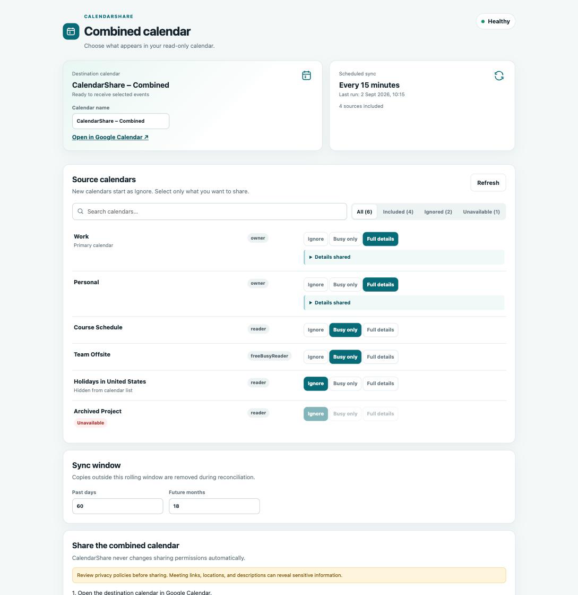
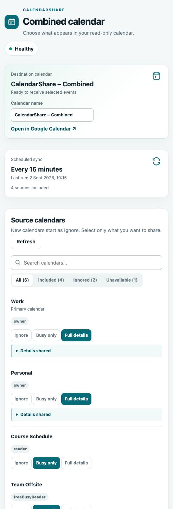
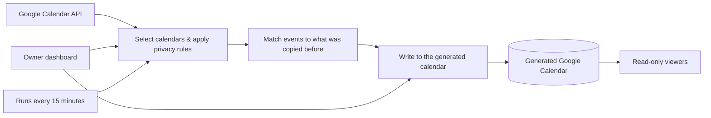

# CalendarShare

[](https://github.com/Homayoon-Movahediasl/calendar-share/actions/workflows/ci.yml) [](LICENSE) [](https://developers.google.com/apps-script)

**Combine every calendar you can see in Google Calendar into one calendar you can safely share.** Pick which calendars to include and how much detail to show for each, and CalendarShare keeps a single generated calendar in sync automatically — read-only, and one-way only.



<p align="center">
  
</p>

Screenshots use synthetic demo data (`npm run preview`); no real calendars are shown.

CalendarShare runs entirely inside your own Google account — there's no external server, database, or company involved. It never modifies your source calendars, and anyone you share the result with only ever sees the one generated calendar.

## Why CalendarShare?

Google Calendar only lets you share calendars one at a time. That's a problem if you want to give someone — a partner, a family member, a collaborator — a single dependable view spanning your work, personal, and subscribed calendars, without handing them access to each one individually. CalendarShare solves that by generating one calendar that mirrors whatever you choose:

```text
your calendars -> automatic sync every 15 min -> one generated calendar -> read-only viewers
```

Highlights:

- Pick exactly what's shared per calendar: full event details, busy times only, or nothing at all.
- Safe to run over and over — a sync never creates duplicates, even if it's interrupted.
- Recurring events, and edits to individual occurrences, are handled correctly.
- Keeps working even if a calendar temporarily fails or gets removed.
- No always-on server, database, or paid service required — it's just your Google account.
- A dashboard to pick calendars, preview changes safely, and check on sync health, from desktop or mobile.

## Quick start

Requirements: Node.js 20 or newer and a Google account. The guided installer walks you through the couple of Google sign-in prompts it needs — you don't need to know anything about Google Apps Script going in.

```sh
npm install
npm run setup:google
npm run deploy
```

This opens a browser window to sign in to Google, then prints a link to your dashboard. Open it, name your generated calendar, choose which calendars to include and how much detail to show for each, then run a dry check before syncing for real. Once you're happy with it, share the generated calendar the normal way in Google Calendar, using **See all event details** (never "Make changes").

Already set this up before? `npm run deploy` updates your existing installation in place. See [Installation](docs/INSTALL.md) for setup, updates, and recovering from a broken deployment.

## How it works

The dashboard shows every calendar Google will let it see. Every 15 minutes, a scheduled job reads whichever calendars you selected, applies the privacy rule you chose for each one, and copies the result into a calendar it created just for this. Every copied event remembers exactly which source event it came from, so re-running the sync is always safe — it never creates duplicates, and once a full read succeeds, anything that shouldn't be there anymore gets cleaned up.



## Privacy model

Privacy is opt-in per source:

| Policy | Shared data |
| --- | --- |
| `IGNORE` | Nothing |
| `BUSY_ONLY` | Time range, all-day state, timezone, and a generic label |
| `FULL` | Title plus optionally location and description |

Attendees, organizers, conference metadata, attachments, reminders, HTML links, and extended properties are not cloned. `FULL` descriptions and locations can still contain text or links entered by a source author, so use `BUSY_ONLY` when that is not acceptable. See [Privacy](docs/PRIVACY.md).

## Limitations

- External calendars you've subscribed to (ICS links) only refresh as often as Google itself refreshes them; CalendarShare can't speed that up.
- If a calendar only shows you limited detail in the Google Calendar app (for example, a colleague's calendar), CalendarShare can only copy that same limited amount.
- By default, only the last 60 days and next 18 months of events are mirrored.
- Google limits how much a script can run per day. Very large calendars may need a longer sync interval.
- Don't edit the generated calendar by hand — any manual change is overwritten on the next sync.
- Only you can open the configuration dashboard; the generated calendar itself is what you share with others.

## Documentation

- [Installation and deployment](docs/INSTALL.md)
- [Privacy and data handling](docs/PRIVACY.md)
- [Architecture and synchronization](docs/ARCHITECTURE.md)
- [Troubleshooting](docs/TROUBLESHOOTING.md)
- [Contributing](CONTRIBUTING.md)
- [Security policy](SECURITY.md)

## Development

```sh
npm ci
npm run check
npm run preview       # dashboard at localhost:4173 with synthetic data, no Google account needed
```

The production bundle has no runtime npm dependencies; Google services are supplied by Apps Script. Do not commit `.clasp.json`, Script Properties exports, calendar IDs, credentials, or event content.

## License

MIT © CalendarShare contributors. See [LICENSE](LICENSE).
